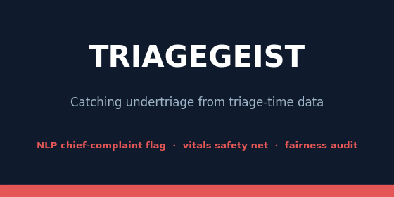

# Triagegeist



A Kaggle notebook that flags emergency department patients at risk of undertriage. It was
written for the Triagegeist hackathon on Kaggle, which was cancelled before any entry was
judged. The last section of this README explains what happened.

## What the notebook does

From the chief complaint and the vital signs recorded at triage, the notebook predicts the ESI
acuity level (1 to 5) and flags the patients who are likely ESI 1 or 2, the ones who should not
be left in the waiting room. Everything is set up to miss as few of those patients as possible:

- The alert threshold comes from an undertriage budget. At most 2% of high-acuity patients in
  the validation split may go unflagged.
- A fixed rule on dangerous vital signs flags a patient whatever the model says: GCS 8 or
  lower, SpO2 below 90, systolic blood pressure below 90, heart rate above 130, respiratory
  rate above 30, or altered mental status.
- An escalation gate passes a case to a clinician when the model is unsure or when the
  complaint is mostly made of words it never saw in training. Conformal prediction sets give
  the range of ESI levels a patient could plausibly be.
- Undertriage rates are compared across sex, age group, language and insurance type, with
  bootstrap intervals and chi-square tests.

The competition data is synthetic and very easy to separate. Every model reaches a ROC-AUC
close to 1.0 on it, and two engineered columns (`news2_score` and `shock_index`) nearly give
the label away, so the notebook reports results with and without them. To get a realistic
number, the main text model is also re-fit on 58,124 real emergency department visits from the
CDC's National Hospital Ambulatory Medical Care Survey (NHAMCS, 2018 to 2022).

## Results

These come from the last full run on Kaggle (version 9, on a GPU). The notebook in this
repository is saved without outputs, so running it again is the way to see them.

High-risk flag (ESI 1-2) on the synthetic validation split:

| Model | Sensitivity | Precision | PR-AUC | Brier | Alert rate |
|---|---|---|---|---|---|
| Structured, all features | 0.980 | 0.993 | 0.999 | 0.005 | 20.5% |
| Structured, without the leaky scores | 0.980 | 0.992 | 0.999 | 0.005 | 20.6% |
| TF-IDF + logistic regression (text) | 0.981 | 1.000 | 1.000 | 0.000 | 20.4% |
| Ensemble (text + structured) | 0.980 | 1.000 | 1.000 | 0.000 | 20.4% |
| Bio_ClinicalBERT (text) | 0.983 | 1.000 | 1.000 | 0.000 | 20.5% |

Other results from the same run:

- On the real NHAMCS visits, quadratic-weighted kappa dropped from 0.999 to 0.372 and the
  high-risk ROC-AUC from 1.000 to 0.760. For comparison, agreement between human triage nurses
  is usually reported at around 0.6 to 0.8 kappa. Isotonic recalibration raised the Brier skill
  score from -0.11 to +0.15, and the decision curve showed a positive net benefit.
- The vitals override caught 40 high-risk patients that the model had missed, for 527 extra
  alerts.
- The conformal sets covered the true level 90.4% of the time against a 90% target, and the
  escalation gate sent 4.9% of cases to a clinician.
- Overall undertriage was 0.5%. No demographic group was missed significantly more often than
  the others. Age group came closest (p = 0.051).

## Running it on Kaggle

1. Create a new notebook and use File > Import Notebook to upload `triagegeist.ipynb`.
2. Add these inputs: the Triagegeist competition data, `aditidutta/bio-clinicalbert` (lets the
   transformer train without internet access) and `reaper0ai/nhamcs-2018-22` (the real data).
3. Turn on a GPU and run all cells. A full run took 10 to 12 minutes on a T4.

The competition data is under a non-commercial license that does not allow redistribution, so
it is not included here.

## Running it locally

```
pip install -r requirements.txt
```

Put `train.csv`, `test.csv`, `chief_complaints.csv` and `patient_history.csv` in a `data/`
folder next to the notebook and open it in Jupyter. Without a GPU, set `RUN_TRANSFORMER=0` to
skip the transformer section. To run the real-data sections, set `NHAMCS_DIR` to a folder that
holds the NHAMCS CSV. Sections whose data is not available skip themselves and the rest of the
notebook still runs.

## Notebook outline

| Sections | Content |
|---|---|
| 1-3 | Problem, checks on the synthetic data, exploratory analysis |
| 4 | Train/validation split, text cleaning, clinical features (qSOFA, SIRS, Charlson index) |
| 5-8 | Evaluation setup, structured model, text model, stacked ensemble, Bio_ClinicalBERT |
| 9-13 | Threshold choice, vitals override, escalation gate, ordinal metrics, conformal sets, validation checks |
| 14-16 | Model comparison, missed patients, fairness audit |
| 17-20 | Feature importance, cost-sensitive decision rule, missing vitals, leakage ablation |
| 21-23 | Validation on real NHAMCS data: kappa, decision curve, calibration, subgroups |
| 24-28 | Model export, clinical use, limitations, conclusion |

## Why the competition was cancelled

Triagegeist was a community hackathon on Kaggle, run with the Laitinen-Fredriksson Foundation,
with a $10,000 prize and 189 teams taking part. Before judging, the host reportedly had a
serious health problem and could not continue. At first Kaggle said the competition could not
be cancelled, so teams, ours included, kept putting time into their entries. In the end it was
cancelled anyway, and not one submission was judged.

We are putting the notebook here so the work is still available. No judge reviewed it, and
none of it has been tested for clinical use.

## Limitations

- The competition data is synthetic. The near-perfect scores on it do not carry over to real
  patients, as the NHAMCS results show.
- The real-data check re-fits the model on a different dataset. It is not a prospective study.
- This is a research notebook. It is not a medical device and should not be used to make
  triage decisions.

## License

The code is released under the MIT License. The competition data and the NHAMCS data keep
their own terms.
